# 🌐 Website Lead Engine (Pre-Built Speculative Outreach Pipeline)

> **Automated Lead Finding, Instant Landing Page Generation & Value-First Outreach for Google Business Profiles.**

---

## 📖 Overview (প্রজেক্ট পরিচিতি)

**Website Lead Engine** হলো একটি স্বয়ংক্রিয় মাইক্রো-এজেন্সি / SaaS পাইপলাইন। এটি বিশ্বব্যাপী গুগল ম্যাপস (Google Business Profile) থেকে এমন সব সফল লোকাল বিজনেস খুঁজে বের করে যাদের চমৎকার রিভিউ ও রেটিং আছে কিন্তু কোনো অফিসিয়াল ওয়েবসাইট নেই।

এরপর সিস্টেমটি স্বয়ংক্রিয়ভাবে তাদের ফটো, রিভিউ এবং সার্ভিস ডাটা নিয়ে সেকেন্ডের মধ্যে একটি আধুনিক মোবাইল-রেসপন্সিভ ওয়ান-পেজ ওয়েবসাইট ডেমো জেনারেট করে। অবশেষে তাদেরকে হোয়াটসঅ্যাপ অথবা কোল্ড ইমেইলের মাধ্যমে প্রিভিউ পাঠিয়ে ডোমেইন ও রিকারিং হোস্টিং সাবস্ক্রিপশনে কনভার্ট করে।

---

## ⚡ Key Value Proposition: The "Pre-Built Demo" Advantage

| সাধারণ কোল্ড আউটরিচ | ভ্যালু-ফার্স্ট স্পেকুলেটিভ আউটরিচ (আমাদের মডেল) |
| :--- | :--- |
| *"আপনাদের কি কোনো ওয়েবসাইট লাগবে?"* | *"আপনাদের ৪৮+ ফাইভ-স্টার রিভিউ দেখে আমরা অলরেডি এই সুন্দর ওয়েবসাইটটি বানিয়ে ফেলেছি: [ডেমো লিংক]"* |
| ক্লায়েন্টকে কাজ দিতে হয় (ছবি, কন্টেন্ট, মিটিং) | জিরো এফোর্ট — ওয়েবসাইট অলরেডি তৈরি ও লাইভ |
| গড় রেসপন্স রেট: **১% - ২%** | গড় রেসপন্স রেট: **১৫% - ২৫%** |

---

## 🔄 End-to-End Workflow Pipeline

```mermaid
flowchart LR
    A[📍 Google Maps Scraper] -->|Filter: No Website & 20+ Reviews| B[🧠 AI Enrichment]
    B -->|Gemini Flash Generates Copy| C[⚡ Dynamic Preview Engine]
    C -->|Next.js / Cloudflare: demo.site/slug| D[📲 Multi-Channel Outreach]
    D -->|WhatsApp / Cold Email| E[🤝 Client Closes]
    E -->|Stripe $19/mo| F[🌐 Custom Domain Live]
```



---

## 📂 Repository Structure

```text
website-lead/
├── README.md                     # Master project overview & blueprint
├── .gitignore                    # Standard ignore rules
├── docs/
│   ├── ARCHITECTURE.md           # Deep-dive technical architecture & Cloudflare SaaS setup
│   ├── OUTREACH_STRATEGY.md      # High-converting WhatsApp & Cold Email scripts, pricing
│   └── ROADMAP.md                # 4-Phase execution plan and milestones
├── schemas/
│   └── lead.schema.json          # Standard JSON schema for scraped & enriched leads
└── examples/
    └── sample-lead.json          # Complete sample lead ready for preview rendering
```

---

## 🛠️ Technology Stack

* **Lead Scraping:** Python (Playwright) / Apify / Outscraper Google Maps Scraper API.
* **AI Enrichment:** Google Gemini 1.5/2.0 Flash (for fast hero copy, service cards, FAQ generation).
* **Multi-Tenant Website Engine:** Next.js 15 (App Router) + Tailwind CSS + Lucide Icons.
* **Hosting & CDN:** Cloudflare Pages (Free global edge caching with dynamic routing).
* **Custom Domain Automation:** Cloudflare for SaaS (Custom Hostnames with automatic SSL).
* **Database & CRM:** Supabase (PostgreSQL) for leads, statuses, and site configurations.
* **Outreach Delivery:** WhatsApp Cloud API / Evolution API (for non-US) & Instantly.ai / Resend (for US/Canada cold email).
* **Billing & Subscriptions:** Stripe / Lemon Squeezy recurring payments ($19 - $29/month).

---

## 💼 Business & Monetization Model

### The Micro-SaaS Subscription Formula:
* **Initial Setup Fee:** **$0** (Free setup minimizes friction).
* **Subscription Fee:** **$19 – $29 / month** or **$199 / year** (includes custom domain, hosting, SSL, and monthly updates).
* **Margin:** Cost per site is ~$0.80/month (Domain ~$10/yr + Free Cloudflare hosting). Net margin is **>90%**.
* **Target Scale:** 100 retained local businesses = **$1,900 - $2,900 / month MRR**.

---

## 🚀 Quick Start Guide

### 1. Inspect Lead Schema & Sample Data
Review the JSON structure used by the preview generator:
```bash
cat schemas/lead.schema.json
cat examples/sample-lead.json
```

### 2. Read Architectural & Outreach Documentation
* [Technical Architecture](file:///docs/ARCHITECTURE.md)
* [Outreach Copywriting & Scripts](file:///docs/OUTREACH_STRATEGY.md)
* [Execution Roadmap](file:///docs/ROADMAP.md)

---

## 📄 License
MIT License. Created for high-performance programmatic agency automation.
