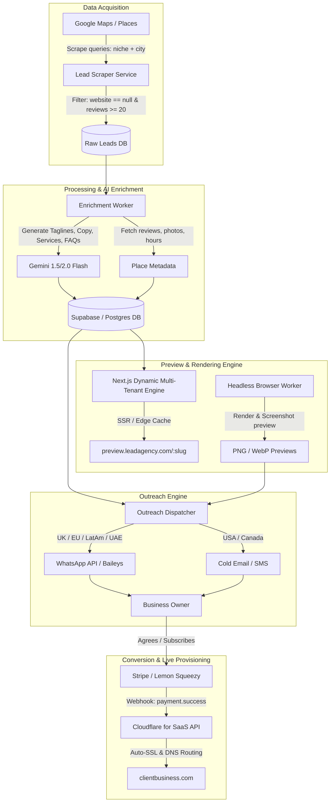

# System Architecture & Technical Design

This document details the complete end-to-end technical pipeline for the **Website Lead Engine** (Automated Speculative Web Design & Outreach).

---

## 1. High-Level Architecture Diagram

---

## 2. Core Subsystems

### Subsystem A: Lead Scraper & Filter
* **Source:** Google Maps via Playwright/Puppeteer or third-party scraping APIs (Outscraper, Apify Google Maps Scraper).
* **Target Criteria:**
  - `has_website == false`
  - `user_ratings_total >= 20` (minimum 20 reviews guarantees active business)
  - `rating >= 4.0` (high social proof to showcase)
  - `formatted_phone_number != null`
* **Output:** JSON object matching `schemas/lead.schema.json`.

---

### Subsystem B: AI Content Enrichment Engine
* **Goal:** Turn raw Google Maps data into full landing page copy in under 3 seconds.
* **Model:** Gemini 1.5/2.0 Flash (high speed, cost-effective).
* **Prompts generated:**
  1. *Hero Tagline & Subtitle:* Highlighting high rating and customer satisfaction.
  2. *Services Cards:* 3-4 standard services inferenced from business category and positive review mentions.
  3. *About Section:* Short, engaging story of the business.
  4. *Customer Testimonial Highlights:* Selecting top 3 authentic 5-star quotes.
  5. *FAQ Section:* 2-3 standard questions (walk-in policies, payment modes, business hours).

---

### Subsystem C: Multi-Tenant Landing Page Preview Engine
Instead of creating individual HTML files or separate hosting instances for every business:
* **Architecture:** Single Next.js (App Router) or Astro codebase deployed on **Cloudflare Pages** or **Vercel Edge**.
* **Dynamic Route:** `/preview/[slug]`
* **Workflow:**
  1. When `/preview/crown-heights-barbershop` is accessed, the edge function fetches the JSON payload from Supabase.
  2. Renders a modern responsive landing page instantly using predefined industry themes (Service, Food & Dining, Health & Beauty).
  3. Automatically injects the business's actual Google reviews, photos, business hours, and click-to-call button.
* **Hosting Cost:** **$0 to negligible** (Cloudflare Pages free tier provides unlimited requests).

---

### Subsystem D: Dynamic Custom Domain Mapping (Post-Sale)
When a client subscribes and wants their own `.com` or `.co.uk`:
* **Cloudflare for SaaS (Custom Hostnames):**
  - Allows you to route external domains (e.g., `www.crownheightsbarbershop.com`) directly to your master Next.js application with automatic SSL generation.
  - Middleware checks `req.headers.get("host")`. If host matches a verified custom domain, it renders that specific client's page directly at root `/` instead of `/preview/[slug]`.
  - Zero manual server configuration needed per client.

---

### Subsystem E: Multi-Channel Outreach Dispatcher
* **WhatsApp Strategy (UK, EU, LatAm, Gulf, APAC):**
  - High open rates (85–95%).
  - Deliver message with personalized thumbnail / GIF showing their live preview.
  - Humanized delays (45–120s random interval) and phone number warm-up to prevent spam bans.
* **Cold Email & SMS Strategy (USA, Canada):**
  - In the US, unsolicited commercial WhatsApp messages are less customary and face stricter anti-spam flags.
  - Dedicated sending domains with DKIM/SPF/DMARC configured via Instantly.ai / Smartlead.
  - Personalized subject line referencing their exact Google review count.
