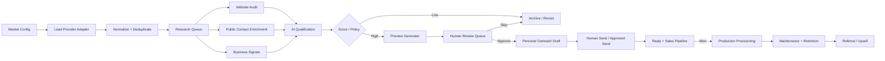

# Website Lead Engine — System Architecture Blueprint

## Architecture Goal
A simple internal, pipeline-first application that can run initially on Raspberry Pi and later migrate to a VPS without redesign. It discovers businesses, researches and scores them, generates previews for strong opportunities, surfaces only the best prospects to Raj, supports human-approved personal outreach, and manages converted clients through maintenance and retention.

## End-to-End Flow

## Deployment Model

### Development
- PC/Mac for coding, testing and local development.
- GitHub is source of truth.
- Docker keeps environments portable.

### Initial production/validation
- Raspberry Pi.
- Docker Compose/services.
- Cloudflare Tunnel for secure dashboard access without exposing router ports.
- Monitor CPU, RAM, disk, temperature and worker concurrency because the Pi already runs other services.
- Heavy external AI work should use APIs rather than local model inference.

### Scale production
Move application/workers to a VPS when resource use, reliability, customer traffic or operational importance warrants it. The application must use environment configuration and portable containers so this is migration, not a rewrite.

## Logical Components

### 1. Web/Admin Application
Responsibilities:
- authentication
- dashboard
- pipeline board
- lead detail/research view
- daily recommendations
- preview review
- approve/skip/hold
- outreach drafts/events
- reply/sales state
- customer maintenance queue
- settings/market configuration

UI must remain minimal and mobile-friendly.

### 2. Provider Adapter Layer
Never couple downstream code to one discovery provider.

Canonical interface concept:
- `searchBusinesses(marketConfig)`
- `getBusiness(providerId)`
- `getAvailableBusinessSignals(providerId)`

Adapters may include approved Places/business APIs, licensed providers and manual CSV/JSON import.

Every external fact stores provenance, provider and retrieval timestamp where practical.

### 3. Normalization & Deduplication
Create a canonical business identity from provider IDs plus normalized name, location, domain, phone and other stable signals. Merge repeated discoveries rather than creating duplicate leads.

### 4. Background Job System
Jobs should include:
- discovery
- normalization/dedupe
- research
- website audit
- contact enrichment
- scoring
- preview generation
- screenshots
- follow-up reminders
- analytics aggregation
- maintenance checks

Requirements:
- idempotency
- retry/backoff
- concurrency limits
- job status/error logging
- independently enable/disable stages
- avoid resource spikes on Raspberry Pi

### 5. Research & Website Audit
Research combines sourced business information and website observations.

Website states:
- none
- unreachable/broken
- weak
- adequate
- strong

Audit signals may include mobile usability, clarity of CTA/contact path, obvious stale/broken content, performance indicators, conversion usefulness and whether the site adequately represents the business. Do not claim subjective weaknesses as facts without recording the evidence/observation.

### 6. Contact Enrichment
Store only legitimate/public business contact routes needed for the workflow:
- email
- phone
- published WhatsApp
- website contact form
- public business social profiles
- decision-maker route when legitimately/publicly available

Each method has source, confidence/status and last verification timestamp where possible.

### 7. AI Qualification Engine
AI receives structured sourced facts and audit observations and returns structured output:
- score 0–100
- confidence
- recommendation
- positive factors
- penalties
- why a website improvement could matter
- recommended outreach channel
- recommended outreach angle

Scoring weights must be configurable. AI cannot fabricate missing facts.

### 8. Daily Recommendation Engine
The system may research many businesses but intentionally limits Raj's daily action queue to a small number of excellent candidates, initially around 2–5/day.

Ranking should consider score, confidence, novelty, contactability, demo readiness and experiment allocation.

### 9. Preview/Site Renderer
Single multi-tenant renderer backed by structured data.

Responsibilities:
- `/preview/[slug]`
- niche template selection
- factual copy/assets
- preview banner/state
- mobile-first design
- CTA based on business type
- preview versioning
- screenshot/thumbnail generation

Keep factual source data separate from generated presentation content.

### 10. Human QA Gate
Before outreach, Raj sees:
- score/reasons
- evidence/provenance
- website audit
- contacts
- preview
- suggested message

Actions:
- approve
- edit message
- skip + reason
- hold
- request regeneration/correction

No Phase-1 outreach bypasses this gate.

### 11. Outreach Module
Initial design is personal outreach, not bulk sending.

Default sender identity: dedicated personal-style mailbox on `d4f.me`, such as `raj@d4f.me`, configured with appropriate domain email authentication.

Store channels generically:
- email
- WhatsApp
- phone
- LinkedIn
- Facebook/Instagram
- contact form
- SMS where appropriate

Email is initial primary channel. The application creates personalized drafts and logs manual/approved sends. Suppression and opt-out state is global for a lead/contact identity.

### 12. Reply/Sales CRM
Lightweight stages:
`contacted → replied → interested → changes_requested → proposal → won/lost/follow_up_later`

Capture objections, requested changes, next action, pricing and outcome so experiments can learn from real data.

### 13. Billing & Provisioning
After willingness-to-pay is validated, integrate billing and automate:
- customer creation
- subscription/payment state
- domain mapping
- SSL
- production publication
- onboarding

Keep preview deployment and customer production deployment distinct.

### 14. Maintenance & Retention
Operational queues include:
- uptime/site health
- SSL/domain status
- edit requests
- form/contact health
- renewal/payment issues
- periodic performance updates
- customer health
- referral/upgrade opportunities

## Suggested Data Domains
Rather than one giant table, implementation can evolve toward:
- `markets`
- `lead_sources`
- `businesses`
- `business_facts`
- `website_audits`
- `contacts`
- `qualification_runs`
- `previews`
- `review_decisions`
- `outreach_events`
- `conversations/replies`
- `sales_opportunities`
- `customers`
- `subscriptions`
- `domains/deployments`
- `maintenance_tasks`
- `analytics_events`
- `jobs`
- `audit_log`

The JSON lead schema can act as the canonical interchange/aggregate representation even if the relational database is normalized.

## Security & Reliability
- secrets only server-side/environment secret storage
- authenticated admin dashboard
- Cloudflare Tunnel for initial remote access
- least-privilege provider/API credentials
- webhook signature verification
- backups
- structured logs
- health endpoint
- retry/backoff
- idempotency keys
- rate limiting
- audit log for important state changes
- no sensitive data in normal logs

## Observability
Dashboard/system metrics should include:
- leads discovered/researched/qualified
- recommendation count
- research/AI/provider failures
- preview generation failures
- outreach/reply/conversion funnel
- retention/customer health
- queue depth/job duration
- Raspberry Pi CPU/RAM/disk during initial hosting

## Architecture Rule
Do not optimize for maximum automation first. Optimize for a reliable measurable loop:

`discover → research → score → recommend → preview → human approve → personal outreach → reply → convert → retain`

Every future automation must preserve that loop's data quality, compliance and observability.